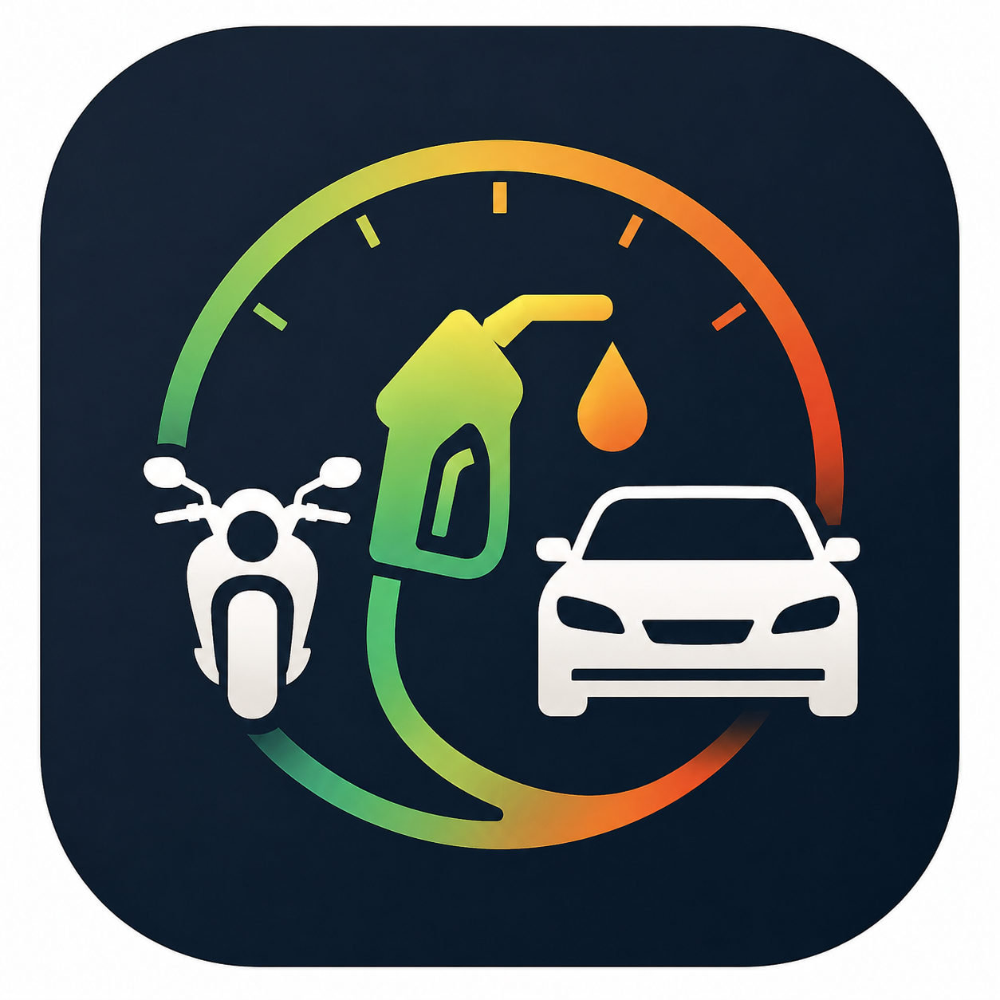

#  Fuel Tracker

A high-performance vehicle fuel telemetry, efficiency, and maintenance tracking web application engineered with authentic **Previous Fill-Up** physics.

[](https://k-692.github.io/FuelTracker/)
[](https://github.com/K-692/FuelTracker)

> [!NOTE]
> **Platform Support Notice:** Support for the native Android and iOS mobile applications has officially ended. FuelTracker is now exclusively developed and maintained as a responsive, cloud-synchronized **Universal Web Application** accessible across all modern browsers and devices.

---

## 🌐 Launch Web Application

You can use the live web app directly in any desktop, tablet, or mobile browser without installation:

👉 **[https://k-692.github.io/FuelTracker/](https://k-692.github.io/FuelTracker/)**

- **Google Authenticated:** Sign in with Google for real-time cloud synchronization backed by Google Cloud Firestore.
- **Universal Browser Layout:** Responsive minimalist UI with Obsidian Dark and Crisp Slate Light theme modes.
- **Automated GitHub Deployment:** Continuously built and deployed via GitHub Actions ([`.github/workflows/deploy.yml`](.github/workflows/deploy.yml)).

---

## 🚀 Key Modules & Capabilities

### 1. Services & Maintenance Tracking (New)
A comprehensive maintenance telemetry system with vehicle-specific tracking:
- **60 Standard Vehicle Components:** Across Engine & Lubrication, Cooling, Ignition & Fuel, Transmission & Drivetrain, Brakes & Wheels, Suspension & Steering, Electrical & ECU, Body & Cabin, and Exhaust & Emissions.
- **Intelligent Vehicle Type Filtering:** Automatically filters components based on vehicle category (Car vs 2-Wheeler / Bike / Scooter) while retaining manual override options.
- **Granular Checklist & Component Charges:** Default status is `No`; toggle `Yes` for components serviced and input individual component charges.
- **Custom Final Invoice Total:** User directly enters the final overall bill amount with optional auto-sum assistance.
- **Universal Editability:** All past service records can be inspected, updated, or deleted with real-time recalculation.

### 2. Engine Oil Telemetry & Navigation Bar Alerts
- **Configurable Service Interval:** Standard 5,000 km engine oil replacement threshold, fully customizable in **Settings**.
- **Real-Time Navbar Status Chip:** Displays remaining kilometers before the next engine oil change directly in the top navigation bar with dynamic status feedback:
  - 🛢️ **Good:** Normal operation with distance countdown.
  - ⚠️ **Warning:** Yellow badge when within 500 km of target.
  - 🚨 **Overdue:** Pulsing red alert when distance exceeds the interval.

### 3. Visual Analytics & Component Trends
- **Component Servicing Frequency & Count Plot:** High-contrast horizontal bar chart ranking parts and systems by how often they have been serviced.
- **Component Price Analysis Over Time:** Interactive SVG time-series chart tracking price evolution, inflation, minimum, maximum, and average charges for any selected component.
- **Fuel Mileage Trajectory:** Precision efficiency curves based on physical previous fill-up consumption.
- **Expenditure Trends:** Refill expenses and pump price trajectory charts.

### 4. Accurate Previous Fill-Up Mileage Formulation
Unlike ordinary trackers that divide trip distance by fuel poured in the current fill, FuelTracker uses the **Previous Fill-Up** method:
- **Formula:** 
  $$\text{Mileage (km/L)} = \frac{\text{Current Odometer} - \text{Previous Odometer}}{\text{Previous Fuel Quantity}}$$
- **Physical Rationale:** Fuel pumped in the *current* refill powers your *future* travel. The distance covered between refills was combusted strictly from fuel loaded in the *previous* refill.
- **Initial Fill Baseline:** The first entry establishes the vehicle's baseline odometer and tank volume.

### 5. Multi-Vehicle Fleet Garage
- Track motorcycles (🏍️), scooters (🛵), passenger cars (🚗), and commercial vehicles (🚙).
- Independent odometer timelines, fuel logs, service history, and lifetime statistics.

### 6. Universal JSON Portability
- Export and import complete fleet profiles, fuel refill logs, and maintenance records via `FuelTracker_AutoBackup.json`.
- Two-stage staged import workflow with validation preview before database population.

---

## 💻 Web App Local Development

```bash
# Navigate to the web_app directory
cd web_app

# Install dependencies
npm install

# Run local development server
npm run dev

# Build production bundle
npm run build
```

Visit `http://localhost:5173/` in your browser.

---

## 🛠️ Project Structure

```text
FuelTracker/
├── .github/workflows/
│   └── deploy.yml              # GitHub Actions Pages deployment
├── App_icon/
│   └── icon.png                # Brand icon
├── web_app/                    # Universal React + Vite Web application
│   ├── public/
│   │   ├── icon.png            # App logo & favicon
│   │   └── favicon.png
│   ├── src/
│   │   ├── components/         # Navbar, Services, ServiceModal, Dashboard, Analytics, Charts, etc.
│   │   ├── domain/             # FuelCalculator, serviceComponents (60 items), serviceCalculator
│   │   ├── services/           # Firebase Auth, Cloud Firestore & unified storage repository
│   │   └── utils/              # DD/Apr/YYYY date formatter
│   └── vite.config.js          # Vite configuration
├── flow.md                     # Architecture and implementation flow log
└── README.md                   # Project overview & documentation
```

---
*Built with ❤️ for Vehicle Owners & Enthusiasts.*
