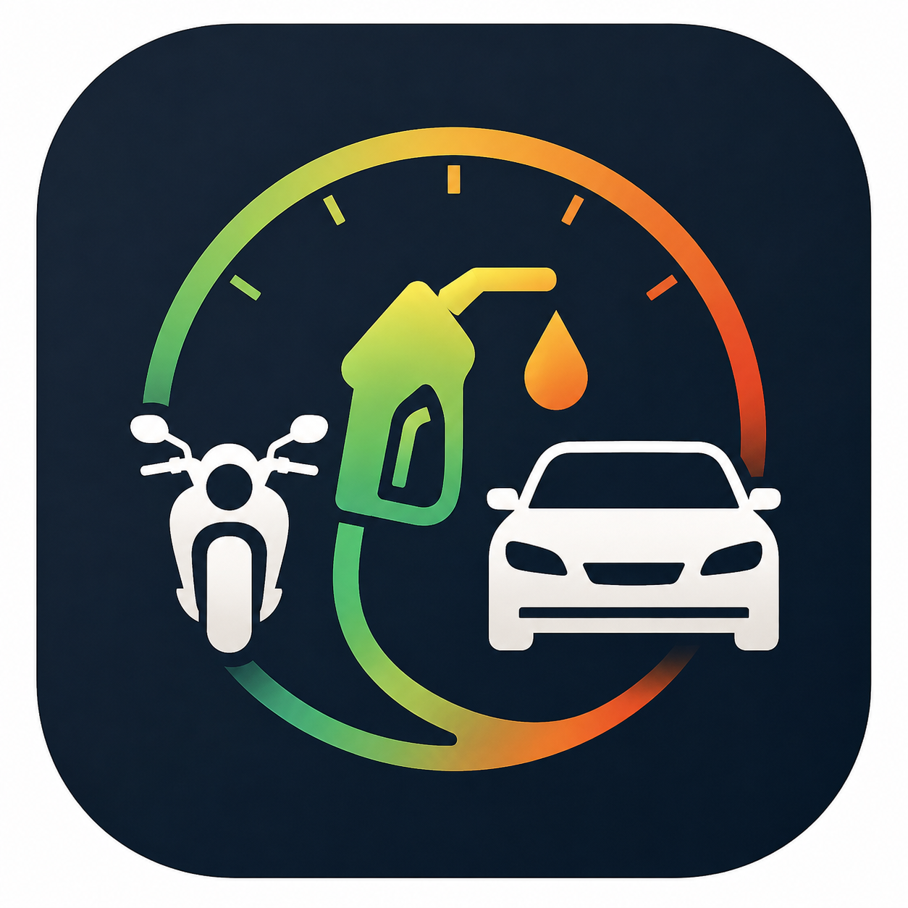
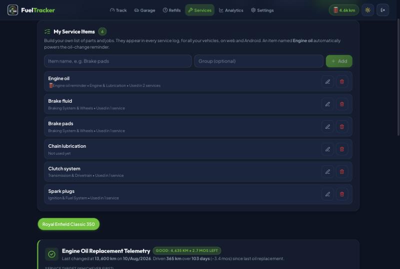
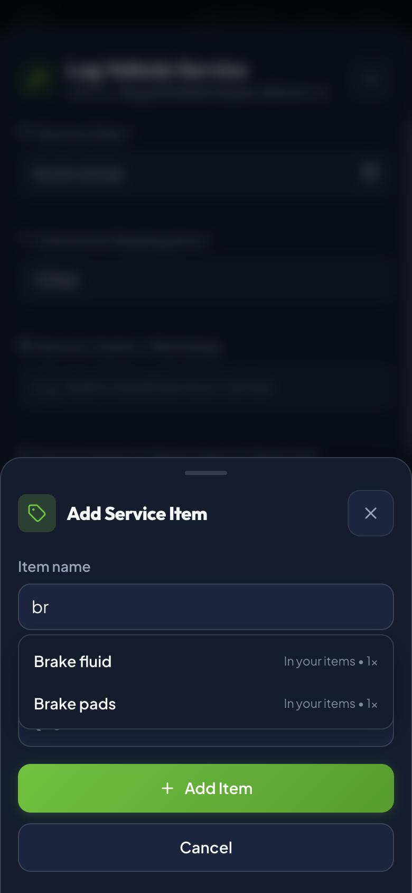
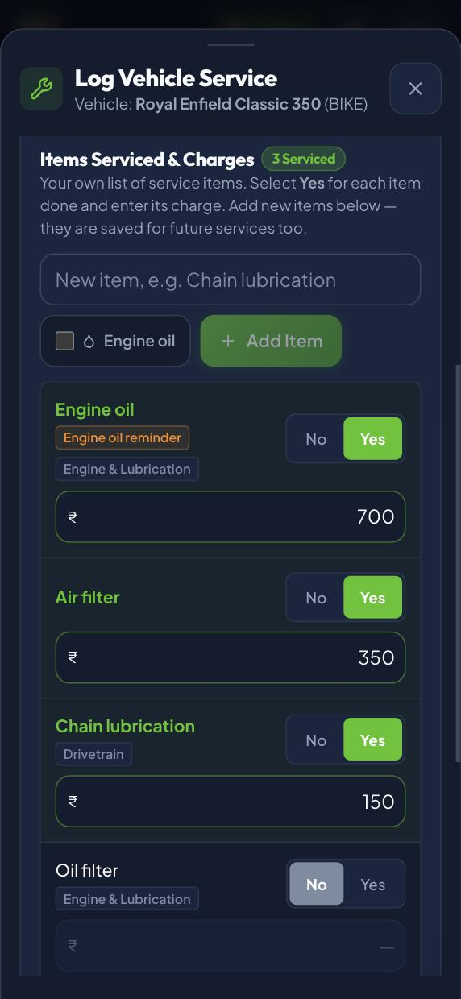

#  Fuel Tracker

A high-performance vehicle fuel telemetry, efficiency, and maintenance lifecycle web application engineered with authentic **Previous Fill-Up** combustion physics and an automotive **Dual-Threshold Engine Oil Telemetry Engine (Distance & Time Duration)**.

[](https://k-692.github.io/FuelTracker/)
[](https://github.com/K-692/FuelTracker/releases/latest/download/FuelTracker.apk)
[](https://github.com/K-692/FuelTracker)
[](https://react.dev/)
[](https://vitejs.dev/)
[](LICENSE)

> [!NOTE]
> **Two apps, one account.** FuelTracker runs as a responsive **web app** (any browser) and a native **Android app** (APK). Both sign in with Google and use the **same Firebase database**, so a refill or service logged on your phone appears on the web instantly — and vice versa.

---

## 📲 Android App (APK)

Download and install — no build tools needed:

👉 **[Download FuelTracker.apk (latest release)](https://github.com/K-692/FuelTracker/releases/latest/download/FuelTracker.apk)** · [All releases](https://github.com/K-692/FuelTracker/releases)

**Install steps**
1. Open the download link on your Android phone (Android 8.1 or newer).
2. Open the downloaded `FuelTracker.apk`. If asked, allow your browser/files app to **install unknown apps** (Settings → Apps → Special access → Install unknown apps).
3. Tap **Install**, open FuelTracker and tap **Sign in with Google** using the same Google account you use on the web app.

**What the Android app includes**
- Google sign-in and live sync with the web app (same Firebase project and Firestore documents).
- Track dashboard: average mileage, distance, fuel spend and running cost per vehicle.
- Refills: log, edit and delete with the Previous Fill-Up mileage method.
- Garage: add, edit, delete and switch vehicles.
- Services: log services using **your own service items**, add new ones from the **Add Item** pop-up (name + price), manage your item list, and see the engine-oil reminder (distance or months, whichever comes first).
- Item-name suggestions while typing, based on your earlier service entries.
- Works offline — changes sync automatically when you're back online.

> [!TIP]
> Updating? Install the newer APK over the existing app — your data lives in your cloud account and is kept.

---

## 🌐 Launch Web Application

You can use the live web app directly in any desktop, tablet, or mobile browser without installation:

👉 **[https://k-692.github.io/FuelTracker/](https://k-692.github.io/FuelTracker/)**

- **Google Authenticated:** Sign in with Google for real-time cloud synchronization backed by Google Cloud Firestore.
- **Mobile-First Responsive UI:** Designed for phones first, scaling up cleanly to tablets and desktops, with Obsidian Dark and Crisp Slate Light themes.
- **Installable:** Add it to your phone's home screen ("Add to Home Screen" / "Install app") for a full-screen, app-like experience.
- **Automated GitHub Deployment:** Continuously built and deployed via GitHub Actions ([`.github/workflows/deploy.yml`](.github/workflows/deploy.yml)).

---

## 📱 Responsive, Cross-Browser UI

The interface is built mobile-first and tested from small 320 px phones up to wide desktop monitors.

| Screen | Navigation | Layout highlights |
| --- | --- | --- |
| **Phones** (≤ 768 px) | Fixed bottom tab bar with large touch targets | 2-column metric tiles, refill tables become stacked cards, forms open as swipe-style **bottom sheets**, full-width segmented controls |
| **Tablets** (769–900 px) | Bottom tab bar | Wider cards and multi-column grids |
| **Desktops** (≥ 901 px) | Top navigation tabs | Centered content, data tables, hover effects; compact header that never overlaps at any width |

**Mobile & browser robustness**
- Safe-area aware (iPhone notch / home indicator) using `viewport-fit=cover` and `env(safe-area-inset-*)`.
- 44 px touch targets on touch screens; hover effects only on devices that truly hover (no "sticky hover" on phones).
- Form fields use a 16 px font on touch devices so iOS Safari never auto-zooms when typing.
- Dynamic viewport units (`dvh`) with `vh` fallbacks, so mobile browser toolbars don't cut off content.
- Background scroll is locked while a dialog is open; `Esc` closes dialogs on desktop.
- Charts measure their container and redraw at the real pixel width, keeping labels readable on phones; tap a point/bar to see its value.
- Graceful fallbacks for older engines (`backdrop-filter`, `:has()`, `overflow: clip`), plus `prefers-reduced-motion`, visible keyboard focus rings, and ARIA roles on navigation, dialogs and notifications.
- Production build targets Chrome/Edge 87+, Safari 14+ (iOS & macOS) and Firefox 78+, with Firebase, React and icons split into separately cached chunks.

---

## 🚀 Key Modules & Capabilities

### 1. Dual-Threshold Engine Oil Telemetry (Distance & Time Duration)
Engine oil degrades through two independent physical vectors: mechanical shear/particulate contamination proportional to distance driven, and chemical oxidation/acidification/condensation over calendar time. Following automotive best practices, FuelTracker monitors both simultaneously:
- **Dual Configurable Thresholds:** 
  - **Distance Interval:** Default `5,000 km` (user-configurable in Settings).
  - **Time Duration Interval:** Default `6 Months` (user-configurable in Settings).
- **"Whichever Comes First" Automotive Rule:** Telemetry evaluates distance driven and elapsed time from your most recent recorded engine oil change. Service alert triggers when *either* limit is reached.
- **Top Navigation Bar Status Chip:** Real-time alert chip in the header displaying both remaining distance and time countdown:
  - 🛢️ **Good:** Green chip with remaining kilometers and months/days countdown.
  - ⚠️ **Warning:** Yellow badge when within 500 km or 30 days of service due.
  - 🚨 **Overdue:** Pulsing danger red alert indicating whether distance, time duration, or both have been exceeded.
- **Maintenance Hub Dual Progress Gauges:** In the **Services** hub, inspect two dedicated progress bars:
  1. *Distance Progress Track:* Shows kilometers driven since last change, remaining distance, and percentage completion against the target odometer.
  2. *Duration Progress Track:* Shows elapsed days and months, days remaining, and target due date (`DD/Apr/YYYY`).
- **Account Safety & Zero-Mutation Guard:** Adding or updating interval thresholds strictly preserves all existing user records, fuel refill entries, vehicle profiles, and service history without overwriting user account data.

### 2. Your Own Service Items (user-defined servicing)
Servicing items are **not pre-defined** — you build your own list, and it is shared by every vehicle on both web and Android:
- **Add Item pop-up:** while logging a service, tap **Add Item** — a pop-up asks for the **item name** and its **price**. On *Add*, the item is marked as serviced with that price and you're back on the service form. Items can also be managed in **Services → My Items**. New items are saved for future services and sync instantly to the other app.
- **Smart suggestions:** as you type an item name, FuelTracker suggests names you've used in earlier service entries (most-used first), so the same part is always recorded under the same name. Picking an existing item reuses it instead of creating a duplicate.
- **Edit or remove items:** rename, group (optional) or remove an item at any time. Removing an item never changes past service records — they keep the item's name and charge.
- **Automatic engine-oil reminder:** an item named **Engine oil** is detected automatically and drives the oil-change reminder — no tick box needed.
- **Per-item charges:** mark `Yes` for each item done, enter its charge, and optionally copy the items' total into the final bill.
- **Existing data is kept:** records created with the old built-in checklist are preserved exactly; the items they used are added to your list automatically (nothing is deleted or rewritten).

| Manage your items (desktop) |
| --- |
|  |

| Add Item pop-up with suggestions (phone) | Item added and marked serviced (phone) |
| --- | --- |
|  |  |

### 3. Visual Analytics & Item Trends
- **Item Servicing Frequency:** Horizontal bar chart ranking your service items by how often they have been serviced.
- **Item Price Analysis Over Time:** Interactive SVG time-series chart tracking minimum, maximum and average charges for any of your items.
- **Fuel Mileage Trajectory:** Precision efficiency curves based on physical previous fill-up consumption.
- **Expenditure Trends:** Refill expenses and pump price trajectory charts.

### 4. Accurate Previous Fill-Up Mileage Formulation
Unlike ordinary trackers that divide trip distance by fuel poured in the current fill, FuelTracker uses the **Previous Fill-Up** method:
- **Formula:** 
  $$\text{Mileage (km/L)} = \frac{\text{Current Odometer} - \text{Previous Odometer}}{\text{Previous Fuel Quantity}}$$
- **Physical Rationale:** Fuel pumped in the *current* refill powers your *future* travel. The distance covered between refills was combusted strictly from fuel loaded in the *previous* refill.
- **Initial Fill Baseline:** The first entry establishes the vehicle's baseline odometer and tank volume.

### 5. Multi-Vehicle Fleet Garage
- Track motorcycles (🏍️), scooters (🛵), passenger cars (🚗), and commercial vehicles (🚙).
- Independent odometer timelines, fuel logs, service history, and lifetime statistics.

---

## 🏛️ System Architecture & Workflow

```text
   ┌──────────────────────────────┐     ┌──────────────────────────────┐
   │        Web App (PWA)         │     │     Android App (APK)        │
   │      React 19 + Vite 8       │     │  Kotlin + Jetpack Compose    │
   └──────────────┬───────────────┘     └──────────────┬───────────────┘
                  └──────────────┬─────────────────────┘
                     Google sign-in (Firebase Auth)
                                  │
                                  │
       ┌──────────────────────────┴─────────────────────────────┐
       │               Domain Mathematical Engines               │
       ├─────────────────────────┬──────────────────────────────┤
       │   FuelCalculator.js     │     serviceCalculator.js     │
       │   - Prev Fill-Up Physics│     - Dual-Threshold Engine  │
       │   - Distance Deltas     │       (5000 km / 6 Months)   │
       │   - Operational Costs   │     - Whichever First Rule   │
       │                         │     - Price Trajectories     │
       └─────────────────────────┬──────────────────────────────┘
                                  │
       ┌──────────────────────────┴─────────────────────────────┐
       │             Unified Data Repository (storage.js)       │
       ├──────────────────────────┬─────────────────────────────┤
       │   Cloud Firestore Sync   │    Local / Offline Cache    │
       │   users/{uid}/vehicles   │    Zero Mutation Safety     │
       │   users/{uid}/services   │                             │
       │   users/{uid}/fuel_entries                             │
       │   users/{uid}/service_items  (user-defined items)      │
       │   users/{uid}/settings/preferences (oil intervals)     │
       └────────────────────────────────────────────────────────┘
```

---

## 💻 Web App Local Development

### Prerequisites
- [Node.js](https://nodejs.org/) (version 18 or higher recommended)
- `npm` (included with Node.js)

### Installation & Setup

```bash
# Clone the repository
git clone https://github.com/K-692/FuelTracker.git
cd FuelTracker/web_app

# Install dependencies
npm install

# Run local development server
npm run dev

# Run code linter
npm run lint

# Build production bundle
npm run build
```

Visit `http://localhost:5173/` in your browser.

---

## 🤖 Android App Development

The Android app lives in [`app/`](app) (Kotlin, Jetpack Compose, Hilt, Firebase Auth + Firestore, Credential Manager).

```bash
# Requires JDK 17+ and the Android SDK (platform 34)
./gradlew :app:assembleRelease     # signed APK -> app/build/outputs/apk/release/FuelTracker.apk
./gradlew :app:assembleDebug       # debug APK
```

- Package name: `com.fueltracker.app`.
- Place your Firebase Android config at `app/google-services.json` (download it from Firebase Console → Project settings → Your apps). It is **git-ignored and never committed**; CI receives it from the `GOOGLE_SERVICES_JSON_BASE64` secret.
- Release signing reads `keystore.properties` (git-ignored) or the `FT_KEYSTORE_PATH`, `FT_KEYSTORE_PASSWORD`, `FT_KEY_ALIAS`, `FT_KEY_PASSWORD` environment variables. The signing key's SHA-1 and SHA-256 must be added to the Firebase Android app, otherwise Google sign-in fails.
- [`.github/workflows/android-release.yml`](.github/workflows/android-release.yml) (run manually from the Actions tab once its secrets are added) builds the signed APK and attaches it to a [GitHub Release](https://github.com/K-692/FuelTracker/releases).

---

## 🛠️ Project Structure

```text
FuelTracker/
├── .github/workflows/
│   └── deploy.yml              # GitHub Actions Pages deployment
├── App_icon/
│   └── icon.png                # Brand icon
├── app/                        # Android app (Kotlin + Jetpack Compose, same Firebase backend)
│   └── src/main/java/com/fueltracker/
│       ├── data/cloud/         # Firestore models & repository (shared schema with web)
│       ├── data/legacy/        # One-time upload of data from the old phone-only app
│       ├── domain/             # Mileage stats, engine-oil reminder, service-item rules
│       └── ui/                 # Compose screens: Track, Garage, Refills, Services, Settings
├── docs/screenshots/           # README screenshots
├── web_app/                    # Universal React + Vite Web application
│   ├── public/
│   │   ├── icon.png            # App logo & favicon
│   │   ├── favicon.png
│   │   └── manifest.webmanifest # Home-screen install metadata
│   ├── src/
│   │   ├── components/         # Navbar, Services, ServiceModal, Dashboard, Analytics, Settings, etc.
│   │   ├── index.css           # Mobile-first design system (themes, breakpoints, responsive tables & sheets)
│   │   ├── domain/             # FuelCalculator, serviceItems (user-defined items), serviceCalculator
│   │   ├── services/           # Firebase Auth, Cloud Firestore & unified storage repository
│   │   └── utils/              # DD/Apr/YYYY date formatter
│   └── vite.config.js          # Vite configuration
├── flow.md                     # Complete architecture and implementation flow log
└── README.md                   # Project overview & documentation
```

---

## 🤝 Contributing to FuelTracker

Contributions, issues, and feature requests are welcome!

1. **Fork the Repository** on GitHub.
2. **Create a Feature Branch** (`git checkout -b feature/AmazingFeature`).
3. **Commit your Changes** (`git commit -m 'Add AmazingFeature'`).
4. **Push to the Branch** (`git push origin feature/AmazingFeature`).
5. **Open a Pull Request**.

Please ensure that `npm run lint` and `npm run build` succeed without errors before submitting pull requests. For UI changes, check the layout at a phone width (e.g. 375 px) as well as on desktop.

---

## 📄 License

This project is licensed under the Apache License 2.0 - see the [LICENSE](LICENSE) file for details.

*Built with ❤️ for Vehicle Owners & Enthusiasts.*
